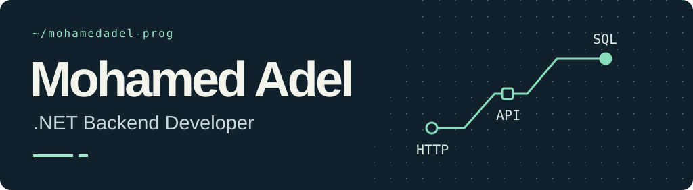

I build REST APIs with **C# and ASP.NET Core**. I’m studying Computer Science at Mansoura University in Egypt and expect to graduate in 2027.

[LinkedIn](https://www.linkedin.com/in/mohamed-adel08/) · [Email](mailto:mmomoadel@gmail.com) · [WhatsApp](https://wa.me/201225167636)

## Inside my backend projects

| In the code | Where to explore |
| --- | --- |
| **Paginating a product catalog** · Follow a listing request through the ASP.NET Core pipeline and see how results are split into pages. | [ProductsAPI ↗](https://github.com/Mohamedadel-prog/ProductsAPI) |
| **Managing access by role** · See how an MVC club management app connects account sign-in with permissions through ASP.NET Core Identity. | [ClubManagementApp ↗](https://github.com/Mohamedadel-prog/ClubManagementApp) |
| **Working with student records** · Explore the .NET 9 endpoints through Swagger and trace how they access data with Entity Framework Core. | [StudentManagementAPI ↗](https://github.com/Mohamedadel-prog/StudentManagementAPI) |

## A contribution to PostgreSQL tooling

**pgexporter** exposes PostgreSQL metrics for Prometheus. Each metric’s `HELP` line describes what it measures, and its `TYPE` line tells Prometheus how to interpret the value. I fixed how pgexporter formats those lines and added tests for its HTTP and bridge endpoints.

[Read the patch and tests in pgexporter #598 →](https://github.com/pgexporter/pgexporter/pull/598)

**My toolkit** · C# · ASP.NET Core · EF Core · LINQ · SQL Server · PostgreSQL · Identity · JWT
